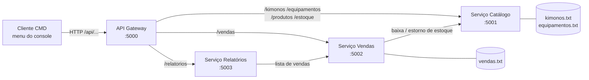

# Arte Suave Store: versão em microserviços

Esta pasta traz o mesmo sistema da loja de Jiu-Jitsu (`Sistema Monolitico E-commerce/`), dividido em serviços independentes que conversam por HTTP/JSON. O monólito original continua intacto na pasta dele.

O menu no CMD é o mesmo, com as mesmas opções e mensagens. A diferença é que o cliente não tem mais regra de negócio nem arquivos: cada operação vira uma chamada ao **API Gateway**, que encaminha para o serviço dono daquele dado.

## Arquitetura



| Serviço | Porta | Responsabilidade | Dados próprios |
|---|---|---|---|
| **Gateway** | 5000 | Ponto único de entrada. Roteia `/api/<recurso>` para o serviço certo e agrega o `/api/saude` | nenhum |
| **Catálogo** | 5001 | Cadastro, consulta, exclusão e movimentação de estoque de kimonos e equipamentos | `kimonos.txt`, `equipamentos.txt` |
| **Vendas** | 5002 | Registra vendas. Pede ao Catálogo a baixa do estoque antes de gravar | `vendas.txt` |
| **Relatórios** | 5003 | Monta o relatório de vendas com total por categoria e total geral | nenhum (consulta Vendas) |
| **Cliente.Cmd** | – | O menu do monólito, agora como cliente HTTP do Gateway | nenhum |
| **Comum** | – | Biblioteca compartilhada: contratos (DTOs), servidor HTTP, cliente HTTP, JSON e arquivo texto | – |

### Princípios aplicados

- **Cada serviço é dono dos seus dados.** Só o Catálogo lê e grava o estoque, e só Vendas grava vendas. Ninguém abre o arquivo do outro; quem precisa pede por HTTP. Os arquivos ficam em `dados/<servico>/`, ao lado de cada executável, no mesmo formato `|` do monólito.
- **Comunicação síncrona por HTTP/JSON**, com `HttpListener` e `HttpClient` do próprio .NET Framework. Não há nenhum pacote NuGet.
- **Consistência entre serviços (compensação).** Numa venda, o serviço de Vendas primeiro baixa o estoque no Catálogo e depois grava a venda. Se a gravação falhar, ele chama `POST /estoque/estorno` para devolver o estoque.
- **Falha isolada.** Se um serviço cair, os outros continuam no ar. O cliente mostra o status de cada um no menu principal (● verde ou vermelho) e as operações que dependem do serviço caído mostram uma mensagem clara em vez de travar.
- **Concorrência.** Os serviços atendem requisições em paralelo, então cada repositório protege a lista com `lock`. A gravação usa arquivo temporário + troca, para não corromper os dados se o processo cair no meio.

## Como rodar

Requisitos: Windows com .NET Framework 4.7.2 ou superior (já vem no Windows 10/11) e um destes para compilar:

- **Visual Studio 2019/2022**: abra `ArteSuave.Microservicos.sln`, clique com o direito na solução, vá em *Configurar Projetos de Inicialização*, escolha *Vários projetos* e marque os 5 executáveis como *Iniciar*.
- **.NET SDK** (`dotnet`): dê dois cliques em `iniciar.bat`. Ele compila tudo, abre uma janela para cada serviço (com o log das requisições) e por último abre o cliente CMD.

Para trocar endereços ou portas, use variáveis de ambiente: `ARTE_SUAVE_GATEWAY`, `ARTE_SUAVE_CATALOGO`, `ARTE_SUAVE_VENDAS`, `ARTE_SUAVE_RELATORIOS` (ex: `http://localhost:6001/`). Isso permite rodar cada serviço em uma máquina diferente.

## API

Todas as rotas abaixo passam pelo Gateway (`http://localhost:5000`). Também dá para chamar cada serviço direto na porta dele, sem o prefixo `/api`.

| Método | Rota | Serviço | Descrição |
|---|---|---|---|
| GET | `/api/saude` | Gateway | Status de cada serviço |
| GET | `/api/estoque` | Catálogo | Kimonos e equipamentos |
| GET | `/api/kimonos` · `/api/equipamentos` | Catálogo | Lista por tipo |
| POST | `/api/kimonos` · `/api/equipamentos` | Catálogo | Cadastra (`201`; `409` se o nome já existe) |
| GET | `/api/produtos/{nome}` | Catálogo | Busca por nome, sem diferenciar maiúsculas |
| DELETE | `/api/kimonos/{nome}` · `/api/equipamentos/{nome}` | Catálogo | Exclui (`204`) |
| POST | `/api/estoque/baixa` · `/api/estoque/estorno` | Catálogo | Movimenta estoque (usado pelo serviço de Vendas) |
| GET | `/api/vendas` | Vendas | Lista as vendas |
| POST | `/api/vendas` | Vendas | Realiza venda: `{"Tipo":"kimono","Nome":"...","Quantidade":2}` |
| GET | `/api/relatorios/vendas` | Relatórios | Vendas, total por categoria e total geral |

Exemplo:

```bat
curl -X POST http://localhost:5000/api/kimonos -H "Content-Type: application/json" ^
     -d "{\"Nome\":\"Kimono Atama Mundial\",\"Cor\":\"Azul\",\"Tamanho\":\"A2\",\"Quantidade\":5,\"Preco\":599.9}"

curl -X POST http://localhost:5000/api/vendas -H "Content-Type: application/json" ^
     -d "{\"Tipo\":\"kimono\",\"Nome\":\"Kimono Atama Mundial\",\"Quantidade\":2}"

curl http://localhost:5000/api/relatorios/vendas
```

Erros sempre voltam como `{"Mensagem": "..."}`, com o status HTTP adequado: `400` para dado inválido, `404` para produto inexistente, `409` para estoque insuficiente ou nome duplicado, e `502`/`503` quando um serviço está fora do ar.

## Do monólito para os microserviços

| No monólito (`Program.cs`) | Agora |
|---|---|
| `struct Kimono`, `Equipamento`, `Venda` | `Comum/Contratos.cs` (contratos JSON) |
| `listaKimonos`, `listaEquipamentos`, `SalvarKimonos()`… | `Servico.Catalogo/RepositorioCatalogo.cs` |
| `RealizarVendaKimono()` / `RealizarVendaEquipamento()` | `Servico.Vendas` (`POST /vendas`) + baixa no Catálogo |
| `ImprimirRelatorioVendas()` (cálculo por categoria) | `Servico.Relatorios` |
| Menus, `LerInteiroPositivo()`, mensagens coloridas | `Cliente.Cmd/Program.cs` |
| `LimparCampo()` e leitura/escrita do `.txt` | `Comum/ArquivoTexto.cs` |

Mudanças de comportamento em relação ao monólito:

- Não é mais possível cadastrar dois produtos com o mesmo nome (antes a venda e a exclusão pegavam sempre o primeiro). O serviço responde `409`.
- Nome, cor, tamanho e categoria não podem ficar em branco no cadastro.
